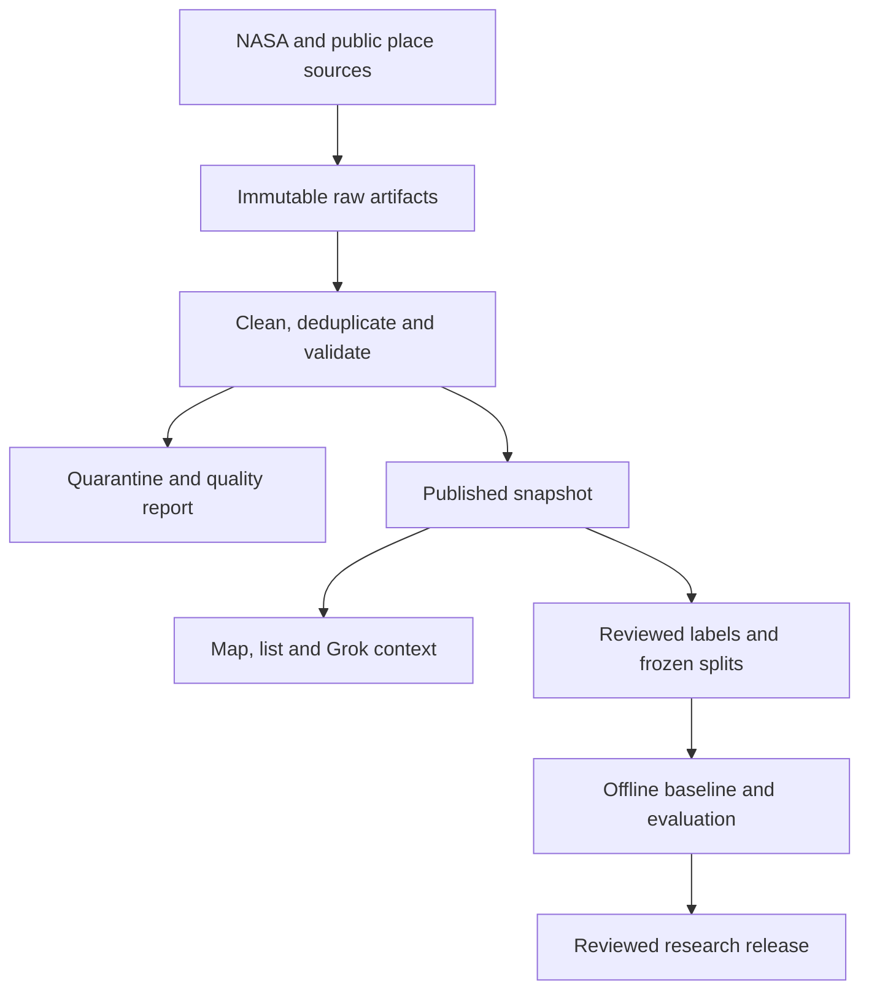

# Data backend and pipeline

Status: the batch commands and one replay snapshot exist. Scheduled storage and model training do not. Parent: [data epic #29](https://github.com/jumiknows/spacex2026Hacks/issues/29). Decision: [ADR 0003](adr/0003-data-foundation.md).

## What to build now

The product needs a reproducible data pipeline. It does not need a newly trained wildfire model to deliver the first useful briefing. NASA supplies thermal detections, deterministic code supplies counts and distances, and pretrained Grok Voice explains the selected evidence.

| Stage | Hackathon P0 | Pilot or research |
| --- | --- | --- |
| Acquire | One bounded FIRMS product and a real replay window | Scheduled regional ingestion |
| Preserve | Original bytes, checksums, source version and retrieval time | Durable private object storage |
| Clean | Schema checks, normalized UTC and coordinates, exact deduplication | Partitioned Parquet and larger backfills |
| Validate | Quarantine, count reconciliation and publication gate | Freshness, drift, cost and recovery monitoring |
| Serve | Immutable snapshot reader behind the existing Next.js routes | Durable current-snapshot pointer and shared cache |
| Label | Human-reviewed briefing evaluation cases | Independent fire-reference labels with uncertainty |
| Model | Versioned attention rule and grounded Voice | Offline baseline experiment, then a measured candidate |
| Share | Dataset manifest and evaluation evidence in the repo | Reviewed Hugging Face dataset and model cards |

## System boundary



Build one Node/TypeScript batch command in `apps/pipeline`, using `packages/domain` and a shared `packages/data` adapter. Move reusable FIRMS parsing out of the web route rather than maintaining two parsers. Keep the Next.js server as the application backend. A Python environment belongs only in the later offline experiment.

Do not add Kafka, Airflow, a vector database or a separate ML service for the demo. These do not resolve the current problem of trustworthy source snapshots.

## Artifact layout

| Proposed path | Contents |
| --- | --- |
| `data/source-registry.json` | Allowed sources, access, intended use and review status |
| `data/replay/<datasetVersion>/` | Small real raw file, normalized rows, quality report and manifest |
| `tests/fixtures/synthetic/` | Synthetic parser and failure cases |
| `artifacts/raw/<source>/<sha256>` | Local or object-store raw bytes, ignored by Git |
| `artifacts/clean/<datasetVersion>/` | Deterministic normalized JSONL, later Parquet |
| `artifacts/runs/<runId>/` | Sanitized run metadata and quarantine records |
| `artifacts/snapshots/<snapshotId>/` | Immutable published manifest and its verified data |
| `artifacts/research/<experimentId>/` | Labels, split manifest, features, metrics and model card |

Paths under `artifacts/` are proposed runtime output, not files already present. The checked-in schema in [data/schemas](../data/schemas) defines the manifest boundary. The builder must enforce cross-field rules below in runtime code.

## Job interface

These commands are implemented in the npm workspace. See apps/pipeline/README.md for immutable run output and verification:

```bash
npm run data:ingest -- --source firms-viirs-snpp --region wa-demo --days 1
npm run data:replay -- --manifest data/replay/<datasetVersion>/manifest.json
npm run data:validate -- --manifest <manifest-path>
npm run data:publish -- --manifest <manifest-path> --mode replay
```

`wa-demo` must resolve to one reviewed, bounded area from configuration. Do not enable caller-supplied URLs, arbitrary global boxes or unbounded history. The data owner chooses the actual replay date after verifying provider availability. Resolve credentials at runtime and redact key-bearing URLs before logging.

Each invocation records a unique `runId`, code commit, transform version, start/end time, parameters without secrets, and terminal state. A failed upstream request creates a failed run, not a successful zero-row dataset. Limit response bytes, rows, duration and retries in configuration. Back off on provider throttling and respect the provider's transaction accounting.

## Cleaning and quality rules

Preserve raw bytes before any transformation. Parse with a CSV library, validate the selected product's required header set, and quarantine invalid rows with raw row number, reason code and original value. Never silently repair swapped coordinates or substitute zero for missing FRP.

| Check | Action |
| --- | --- |
| Missing required headers or unexpected HTML/error body | Fail run, retain sanitized diagnostics, preserve current snapshot |
| Invalid coordinate, date, HHMM or required identity | Quarantine row and block automatic publication |
| Exact duplicate identity and identical values | Keep one row, record duplicate lineage |
| Same identity but different values or product revision | Preserve both source versions and block ambiguous publication |
| Unknown confidence category | Quarantine for parser review, never reinterpret as a percentage |
| Missing optional FRP | Keep null and record missingness |
| Observation outside configured space or acquisition window | Count as excluded with a reason |
| No qualifying rows after a valid response | Publish an explicit empty snapshot if all other gates pass |

Reconcile `rawRows = retainedRows + duplicateRows + excludedRows + quarantinedRows`. Count data records, excluding the header and blank lines. Every retained observation resolves to raw artifact hash and row number. Low confidence observations are retained and inspectable, even though the attention rule excludes them. A quality report includes counts by reason, confidence, satellite and acquisition date, plus missingness and earliest/latest observation time.

P0 publication is strict: no quarantined rows, no conflicting duplicates, all hashes verified, all required fields valid, reconciled counts and known source attribution. Investigate and rerun failures. Do not add an undocumented tolerance to get a demo to pass. The report distinguishes data quality from geographic coverage, which remains unknown unless independently documented.

## Versioning and correction

`datasetVersion` hashes canonical source product versions, raw hashes, transform version, schema version, scope and normalized-data hash. Stable sorting and serialization must reproduce the same value for the same input and transform. Keep transient run timing out of this digest.

`snapshotId` additionally identifies an immutable manifest containing its mode, retrieval metadata and observation cutoff. Hash the canonical manifest with the `snapshotId` field omitted to avoid a self-reference. Define one sorted-key UTF-8 JSON serialization and deterministic row order in shared code. Re-fetching identical bytes can produce the same dataset version with a new snapshot and retrieval time. The response's `generatedAt` is an assembly timestamp, not a freshness claim.

Store both acquisition time and fetched time. `availableAt` is nullable unless there is evidence of when that source record was actually available. Do not fill historical availability with acquisition time. FIRMS archive revisions can replace earlier products, so keep the original product version and distinguish revised science data from what the live service delivered at the time.

Correct a published artifact by producing a new version with a supersedes reference. Never overwrite bytes behind an existing hash or change the data associated with a snapshot ID.

## SnapshotStore contract

Implement `get(snapshotId)`, `putVerified(manifest, artifacts)` and `getCurrent(source, region)` behind one server-only interface. A local filesystem implementation supports development and a bundled read-only store supports the checked-in replay on deployment. An in-memory live store is permitted for the first demo, but its restart and multi-instance limitations must be explicit.

Write artifacts into staging, validate and hash them, then write the immutable manifest last. Move the current pointer only after the full set is readable. Local publication uses atomic rename on the same filesystem. A durable object adapter must use conditional writes or a single publisher. Readers never observe a partially written snapshot. Failed runs leave the last good pointer intact and report its age.

The existing observation and context routes resolve exact IDs through this interface. Add `GET /api/snapshots/:id/provenance` for a sanitized manifest and quality summary. Unknown IDs return a typed unavailable response. Only published public metadata reaches the browser. Do not expose storage credentials, internal object paths, raw provider error bodies or a public ingestion trigger.

## Pilot persistence

After the P0 flow works, run the same batch job on a managed scheduler every 15 minutes for a bounded region. This is a proposed polling policy, not a detection-latency claim or guaranteed scheduler precision. Pick the host and storage vendor during deployment after checking pricing and limits.

Use private object storage for raw and normalized artifacts, with short-lived server access and a public sanitized metadata route. Persist job state, last successful snapshot, retry count and heartbeat. Add a per-region lock, retry cap and backfill checkpoint. Explicitly distinguish failed ingestion from a valid empty feed.

Start with object manifests as the catalog. Add managed Postgres with PostGIS only when multiple regions, spatial queries, subscriptions or durable reviewer workflows justify it. The proposed tables are `ingestion_runs`, `source_artifacts`, `dataset_versions`, `snapshots`, `snapshot_observations`, `places`, `label_reviews` and `experiment_runs`. IDs and hashes follow the same contracts. Migrations, indexes, role permissions and backup restore tests belong to that ticket, not a pretend database provisioned by this plan.

## Operational acceptance

- Replaying the same raw input and transform produces the same normalized bytes and dataset version.
- A parser failure and a simulated process interruption leave the previous published snapshot usable.
- Empty, stale, failed and replay responses are distinct across map, list and Voice.
- Measure job duration, last successful fetch, rejected-row count, publication lag, storage use and API cost. Record targets separately from observed results.
- Proposed pilot targets are API p95 below one second for cached bounded reads and a visible failure state after two missed polling intervals. Measure before advertising them.
- Retain the small public demo snapshot and its manifest. Set retention and deletion policies for larger pilot artifacts before scheduling. Do not collect microphone recordings or household locations by default.

The startup advantage to investigate is reliable, understandable evidence and a repeatable community workflow. More infrastructure or a larger model does not by itself validate demand.
