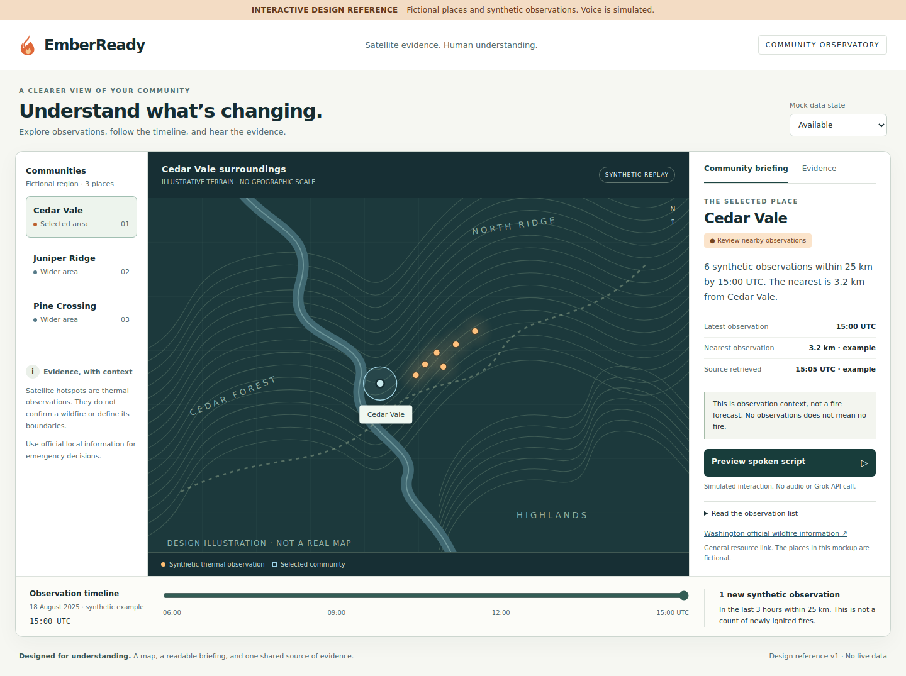

# Interactive design reference

Open [index.html](index.html) in a browser. It is a self-contained, dependency-free mockup with fictional communities, synthetic observations and an illustrative terrain drawing. It makes no network calls.

Try community selection, the replay slider, the evidence tab, the data-state selector, the observation list and the spoken-script preview. Selection and replay update the briefing together. The script preview uses local text, not Grok or browser speech synthesis.

This is a visual and interaction reference for [#16](https://github.com/jumiknows/spacex2026Hacks/issues/16), [#18](https://github.com/jumiknows/spacex2026Hacks/issues/18), [#20](https://github.com/jumiknows/spacex2026Hacks/issues/20) and [#21](https://github.com/jumiknows/spacex2026Hacks/issues/21). It is not the submission application, a scientific map, a real event replay or sponsor API evidence.

[Mobile screenshot](preview-mobile.png)

## Implementation notes

- Preserve the clear place, cutoff, source and unknown-data labels.
- Replace the SVG illustration with MapLibre and actual source coordinates.
- Replace every synthetic record with the shared snapshot contracts.
- Keep source inspection available beside the public briefing. Operational job controls belong in an internal view.
- Replace the local script preview with real Grok Voice, preserving transcript, stop and context cancellation.
- Test keyboard navigation, mobile layout, reduced motion, WebGL failure and the actual Voice experience in the production app.

The mockup was created through ChatGPT. It is not evidence that implementation happened in Cursor.

## Verification performed

Checked on 2026-10-18 UTC with Playwright 1.51.1 and Chromium Headless Shell 134. Community changes, timeline filtering, distinct unavailable/stale/empty states, script dialog and Escape, keyboard tab selection and absence of browser script errors passed. Layouts at 1440, 960 and 390 pixels had no horizontal overflow. Desktop and mobile screenshots were visually inspected.

These checks validate the synthetic reference only. They do not validate NASA ingestion, map projections, assistive-technology compatibility, Grok Voice or production application behavior.
