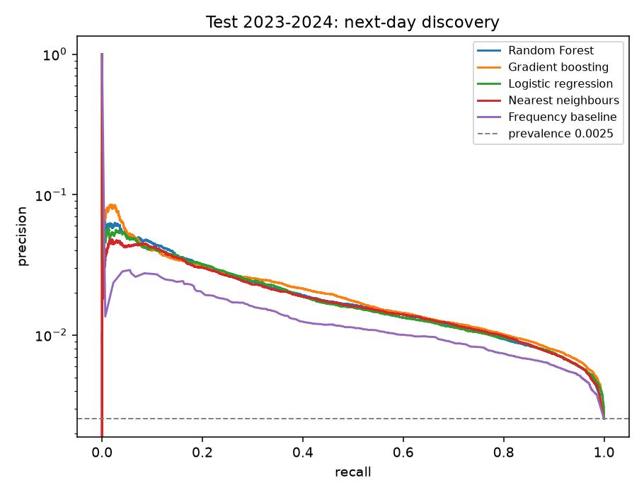
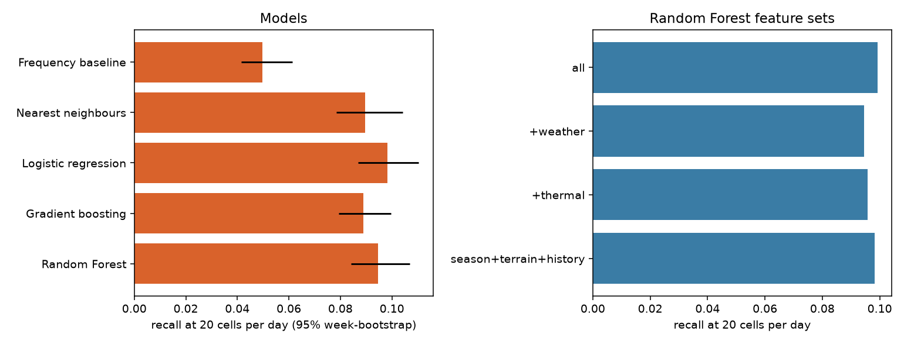
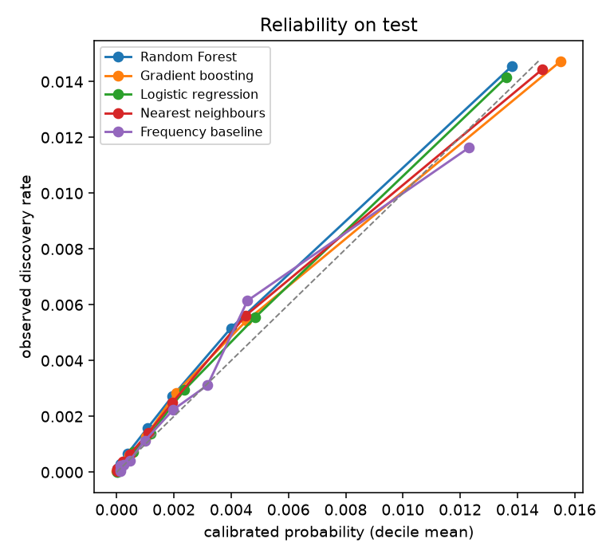
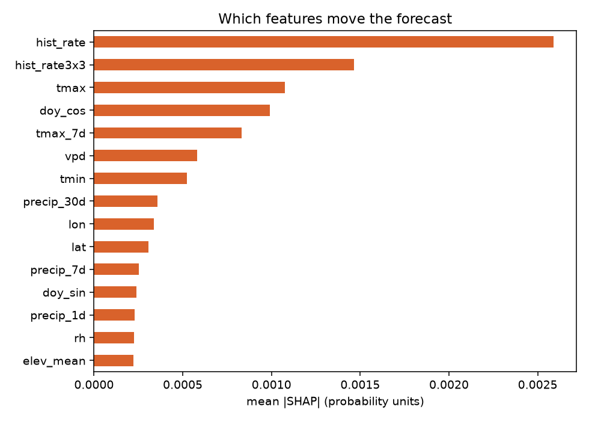
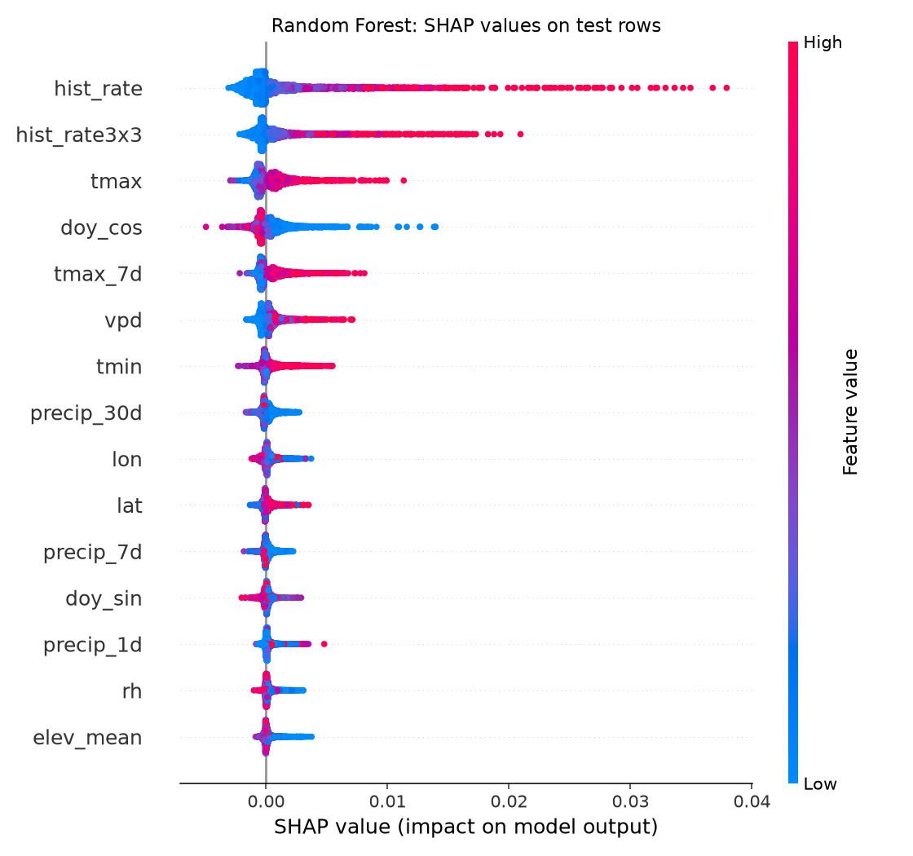
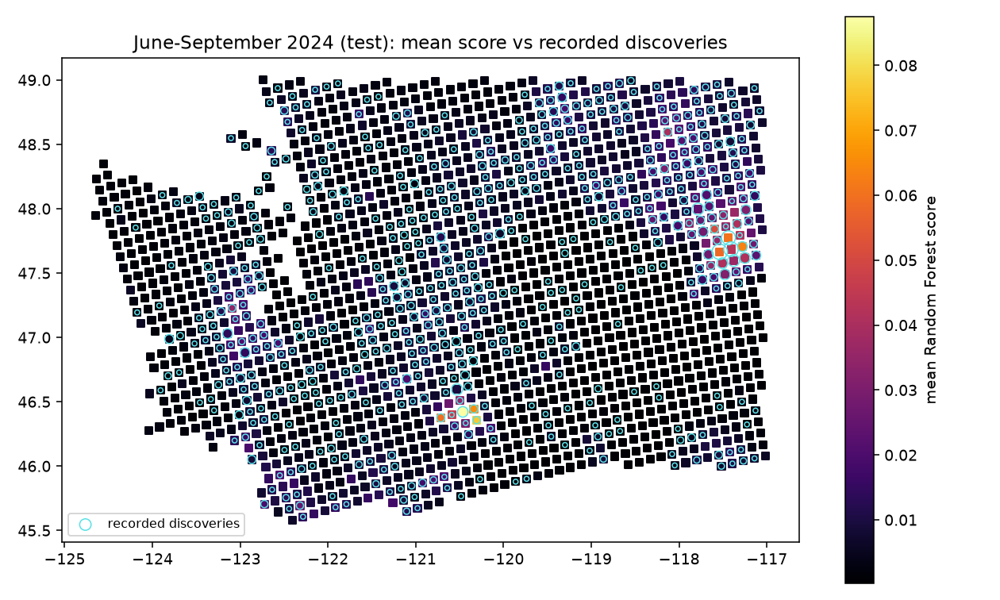

# wa-discovery-nextday-v1: next-day wildfire discovery in Washington

Status: offline research. Retrospective association study. Weather comes from a reanalysis that was not available in real time, so results support no early-warning claim. Unset. The product owner and a qualified domain reviewer must set numeric thresholds before any model can be promoted. Results stay offline research.

## Question

Rank 10 km equal-area cells in Washington by whether at least one wildfire discovery is recorded in FPA FOD on the target day.
 The outcome is a recorded discovery in FPA FOD, not physical ignition, spread, damage or personal safety. A cell-day without a record is a database outcome, not proof that no fire occurred.

## Data

| Source | Role | Access |
| --- | --- | --- |
| FPA FOD 7th edition, US Forest Service | Labels | Public map service, Washington records 2013 to 2024 |
| NASA FIRMS VIIRS S-NPP yearly archives | Prior thermal detections | Public download |
| NASA POWER daily (MERRA-2 reanalysis) | Weather and topsoil wetness on the previous day | Public API |
| NASA SRTMGL3 via LP DAAC | Elevation, relief and slope | NASA Earthdata Login token |
| US Census 2023 cartographic boundary | State outline for the grid | Public download |

Every raw file is pinned by SHA-256 in [sources.json](sources.json). The grid has 10 km equal-area cells (EPSG:5070) whose centres lie inside Washington.

Of 18777 FPA FOD records, 18299 were retained. 478 fell outside the gridded state and 0 lacked a usable day or point. They form 17306 positive cell-days (993 records shared a cell-day with another record).

Positive cell-days per year (adequacy audit):

| 2013 | 2014 | 2015 | 2016 | 2017 | 2018 | 2019 | 2020 | 2021 | 2022 | 2023 | 2024 |
| --- | --- | --- | --- | --- | --- | --- | --- | --- | --- | --- | --- |
| 1258 | 1415 | 1569 | 1161 | 1248 | 1541 | 1350 | 1447 | 1655 | 1425 | 1719 | 1518 |

## Features

Every feature for target day D uses data dated D-1 or earlier. Availability per group is in [feature-availability.json](feature-availability.json). Tests in `research/tests` check that adding data on or after D never changes a feature.

- Season: day-of-year cycle, weekend, the 1 to 7 July window
- Terrain: mean elevation, relief and slope per cell
- Thermal: VIIRS detections in the cell and its 3x3 and 5x5 neighbourhoods over 1, 3, 7 and 30 days, fire radiative power and days since the last detection
- Weather: previous-day heat, humidity, vapour-pressure deficit, wind, rain totals, dry-spell length and topsoil wetness
- History: the cell and neighbourhood discovery rate in training years, leave-one-year-out inside training

## Splits

Training 2013 to 2020, validation 2021 to 2022 for tuning and isotonic calibration, test 2023 to 2024 evaluated once. A separate transfer test holds out northeast Washington with a one-cell buffer. Row hashes are in [split-manifest.json](split-manifest.json). Training keeps every positive and a weighted sample of 30 negatives per positive. Validation and test use the full natural population.

## Results on the frozen test

Test rows: 1279981 cell-days with 3237 positives (prevalence 0.253%). The review budget is 20 of 1751 cells per day (1.1%). Intervals resample whole calendar weeks.

| Model | PR-AUC | 95% interval | Recall at 20/day | 95% interval | Precision at budget | False positives per 1,000 cell-days | Brier |
| --- | --- | --- | --- | --- | --- | --- | --- |
| Gradient boosting | 0.0221 | 0.0173 to 0.0282 | 8.9% | 7.9 to 10.0% | 2.0% | 11.20 | 0.00249 |
| Random Forest | 0.0211 | 0.0172 to 0.0250 | 9.5% | 8.4 to 10.7% | 2.1% | 11.18 | 0.00250 |
| Logistic regression | 0.0207 | 0.0173 to 0.0242 | 9.8% | 8.7 to 11.0% | 2.2% | 11.17 | 0.00250 |
| Nearest neighbours | 0.0196 | 0.0169 to 0.0229 | 9.0% | 7.8 to 10.4% | 2.0% | 11.20 | 0.00250 |
| Seasonal-regional frequency baseline | 0.0134 | 0.0112 to 0.0160 | 5.0% | 4.1 to 6.1% | 1.1% | 11.30 | 0.00251 |

Chance PR-AUC equals the prevalence, 0.0025. The strongest model by PR-AUC was Gradient boosting. At the same budget the Random Forest recalled 9.5% of recorded discoveries against 5.0% for the frequency baseline, a difference of 4.5 points. Tuned settings are in [metrics.json](metrics.json).





Run history: the first complete run stopped after scoring the test years because one fitted model could not be saved. After that fix the unchanged pipeline, configuration and seed were run again and produced the same test metrics, so no setting was changed after seeing the test.

### Feature sets (Random Forest, same settings)

| Features | PR-AUC | Recall at 20/day | 95% interval |
| --- | --- | --- | --- |
| season+terrain+history | 0.0213 | 9.8% | 8.5 to 11.2% |
| +thermal | 0.0211 | 9.6% | 8.4 to 10.9% |
| +weather | 0.0210 | 9.5% | 8.2 to 10.7% |
| all | 0.0215 | 9.9% | 8.8 to 11.2% |

### Slices (Random Forest)

Each slice applies the 20-cell budget within the slice. A smaller pool makes the budget easier to fill, so slice recall is not comparable with the overall figure. Compare PR-AUC against each slice's prevalence instead.

| Slice | Positives | Prevalence | PR-AUC | Recall at 20/day |
| --- | --- | --- | --- | --- |
| year 2023 | 1719 | 0.269% | 0.0236 | 8.8% |
| year 2024 | 1518 | 0.237% | 0.0188 | 10.1% |
| fire season jun sep | 2483 | 0.581% | 0.0238 | 9.1% |
| off season | 754 | 0.088% | 0.0116 | 10.7% |
| west of cascades | 1309 | 0.249% | 0.0223 | 13.1% |
| east of cascades | 1928 | 0.256% | 0.0221 | 15.4% |
| no prior detection 7d 3x3 | 2847 | 0.245% | 0.0201 | 10.5% |
| prior detection 7d 3x3 | 390 | 0.324% | 0.0288 | 40.0% |

### Geographic transfer

In northeast Washington, a forest that never trained there and had no history features reached PR-AUC 0.0138 and recall 20.5% at 20 cells per day within the region. The forest trained with the region reached 0.0193 and 32.4%. The region has 512 test positives.

### Calibration

Scores were mapped to probabilities with isotonic regression fitted on the natural validation population. Brier scores are compared with a constant prevalence forecast in [metrics.json](metrics.json).



## Explanations

SHAP values for the Random Forest come from 3000 test rows (half recorded discoveries, half not). Mean absolute contribution, largest first:

| Feature | Mean abs SHAP |
| --- | --- |
| hist_rate | 0.0026 |
| hist_rate3x3 | 0.0015 |
| tmax | 0.0011 |
| doy_cos | 0.0010 |
| tmax_7d | 0.0008 |
| vpd | 0.0006 |
| tmin | 0.0005 |
| precip_30d | 0.0004 |
| lon | 0.0003 |
| lat | 0.0003 |





Example: cell `wa10k_-187_284` on 2024-07-07 had a recorded discovery and scored 0.143. Its largest contributions were hist_rate +0.037, hist_rate3x3 +0.021, doy_cos +0.013, tmax +0.011, slope_mean +0.008.

Nearest-neighbour permutation importance on validation (drop in PR-AUC when a feature is shuffled):

| Feature | PR-AUC drop |
| --- | --- |
| hist_rate | 0.1263 |
| hist_rate3x3 | 0.0354 |
| doy_cos | 0.0184 |
| precip_30d | 0.0131 |
| precip_7d | 0.0121 |
| tmin | 0.0088 |
| tmax | 0.0071 |
| rh | 0.0061 |



## Limitations

- Weather is reanalysis published after the fact, so this is a retrospective association study and not an early-warning result.
- The FIRMS yearly archive mixes near-real-time and later standard-processing rows. Values can differ from what was visible on the day.
- Thermal detections can belong to a fire that is later recorded as a discovery nearby. Part of the signal is detection of fires already burning, not prediction of new ones.
- FPA FOD locations vary in precision and completeness by agency and year. Coverage gaps become false negatives.
- Two test years with correlated events give wide intervals. The test was evaluated once.
- No human reviewer has examined labels or errors. No decision threshold has been set.

## Reproduce

```bash
cd research
python3 -m venv .venv && .venv/bin/pip install -r requirements.txt
echo 'EARTHDATA_TOKEN=...' > .env   # NASA Earthdata Login, needed for SRTM
.venv/bin/python -m wildfire.acquire
.venv/bin/python -m wildfire.run
.venv/bin/python -m wildfire.report
```

Run on commit `ff0531d`, Python 3.12.12, 42 minutes on a 12-core CPU without a GPU. Seed 29.
